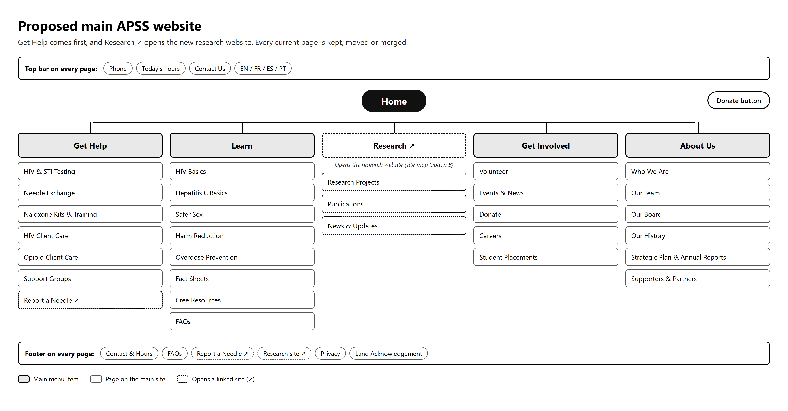

# Usability Insights: Check-in 2

October 21, 2026. Erin Hidlebaugh from APSS and Dr. Tim Maciag met with all five of us: Samuel, Muhammad, Chop, Oluwateniola and Marie.

## What happened

Our plan going in was to run our questionnaire with Erin and Tim: 8 tasks and 7 questions, printed and ready ([Usability-Questionnaire.pdf](Usability-Questionnaire.pdf)). Once we started walking them through the prototype, the conversation took over, and we spent our ten minutes showing the pages and talking through the design. We never got to the tasks, so we have no task scores to chart. Tim told us it was fine to write up the feedback we did get, so that is what this is.

## What they told us

Both of them liked the prototype. They liked the colours and the overall look, and neither of them asked us to change anything on the research site.

Then they gave us something we did not expect. If we think we can handle it, we can redesign the main APSS website as well. The main site would become the front door, and Research in its menu would take people over to the site we have been building.

## What we are taking from it

The colours and style are staying. On October 7 Erin asked for neutral colours and a clean look, "not a colouring book", so hearing that she likes the result tells us we read her right. Those colours and fonts become our theme settings when we start in WordPress.

We are not treating "they liked it" as proof that the site is easy to use. Erin and Tim both know the project well, and nobody was trying to find anything. Someone seeing it for the first time could still get lost looking for a poster or the link to reportneedles.ca. We will not know until we run the tasks with people outside the project.

The main-site offer also backs up something Erin told us early on: APSS wants two separate sites. It is on one of our empathy maps. So the research site stays its own thing, and the main site needs to point to it clearly.

We have already started on that. We went through the live main site and mapped what is there now. Research is the last item under About Us, reportneedles.ca is not in any menu, and some menus run to nine items. Our proposed version puts Get Help first and adds Research to the main menu. The full notes are in [Main-Site-Redesign-Notes.md](../../design/sitemaps/Main-Site-Redesign-Notes.md).

Figure 1: Our proposed main site. Research in the menu opens the research website.

## Before the November 4 check-in

- Run the questionnaire with at least five people who have never seen the site: classmates for sure, and community members if Erin can help us find some.
- Put the results in our spreadsheet and chart task success and ease for the next write-up.
- Decide as a team whether we take on the main site, then confirm with Erin.
- Set up the WordPress theme with the colours and fonts they approved.
